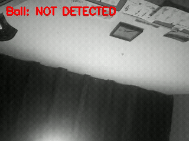

# Ball Balancing Robot

A ball balancing 3-RRS parallel robot control and simulation platform.

## Setup

- [PC Setup & Usage](wiki/pc_setup.md)
- [Raspberry Pi Setup & Usage](wiki/raspberry_setup.md)

## Architecture

The program entry point is the [src/main.py](src/main.py) file, where the `ManagerOrchestrator` is defined.

The orchestrator launches $N$ managers, each in a separate process. The managers communicate through a Zenoh session, which works seamlessly both locally (via shared memory/IPC) and across the network.

There is a manager for each task:

- **CameraManager**: Deals with frame acquisition and streaming using GStreamer. The source can be the physical camera of the Raspberry Pi (`libcamerasrc` or `v4l2src`), a video file, or `videotestsrc` for simulation.
- **BallDetectionManager**: Subscribes to camera frames and produces ball coordinates if detected. The manager implements a detection strategy that is modular. The current implementation uses an HSV color segmentation filter.
- **ControllerManager**: Implements the control strategy (PID / state-space). *(In progress)*
- **KinematicsManager**: Implements the forward and inverse kinematics for the 3-RRS parallel platform.
- **MotorControlManager** (`PiMotorActuator`): Actuates the motors to balance the ball on the platform.

Each manager can run either on the PC or directly on the Raspberry Pi. The execution modes determine which managers are launched:

- Mode `pi`: All managers run on the Raspberry Pi, which functions as a standalone machine from camera capture to motor actuation.
- Mode `sim`: All managers run in simulation on the PC. The camera stream and motors are simulated, while all algorithms remain platform-agnostic.
- Mode `pi-hw` combined with `pc-proc`: The Raspberry Pi acts as the hardware interface (streaming camera frames and accepting motor commands) while all heavy computation (computer vision, control loop) is offloaded to the PC. The two machines are typically connected directly with an Ethernet cable or over the local network.

## Ball Detection using the HSV Filter

The ball detection algorithm assumes the ball has a bright, distinguishable color (e.g. vibrant green).

This allows the ball detector to be implemented as an HSV filter with robust post-processing.

The detection pipeline consists of the following steps:

1. **HSV Thresholding**: Converts BGR to HSV and isolates target color pixels within configured range limits.
2. **Morphological Opening**: Removes small background noise specks using an elliptical structuring element.
3. **Morphological Closing**: Fills internal holes and bridges shallow gaps caused by surface reflections.
4. **Connected Component Analysis (CCA)**: Labels distinct regions and retains strictly the largest connected component.
5. **Area Threshold**: Rejects the component if its pixel area is below `min_area`.
6. **Convex Hull**: Bridges specular reflection notches along the perimeter to restore the true convex boundary.
7. **Circularity Filter**: Evaluates shape circularity $\left(\frac{4 \pi \cdot \text{Area}}{\text{Perimeter}^2}\right)$ against `min_circularity` to discard non-spherical objects (cables, edge flares).
8. **Minimum Enclosing Circle**: Fits the circle boundary to compute the ball's geometric center $(x, y)$ and radius.

If no component survives the filter, the ball is marked as **NOT DETECTED**.

### Detection in Action

